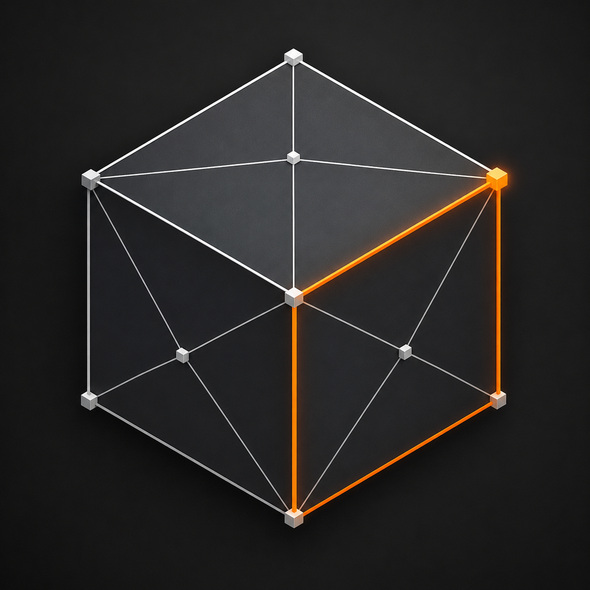

<p align="center">
  
</p>

<h1 align="center">Blender Local</h1>

<p align="center">
  A Blender-style 3D app for iPad (and iPhone), built on the real Blender: the <code>bpy</code> module, bundled inside the app.
</p>

---

Blender Local bundles Blender's own `bpy`, cross-compiled for iOS arm64 in
[python-ios-lib](https://github.com/yu314-coder/python-ios-lib), and draws a
touch-native interface over it with SwiftUI and Metal. Blender holds the scene.
Every button, menu and field runs Blender's own operators and properties, and
the viewport draws what Blender evaluated after each change. Modifiers,
sculpting, rendering and file formats are Blender's, not copies of them.
Everything runs on the device, offline.

**[docs/blender-local.md](docs/blender-local.md)** is the reference for the app:
where the files are, how the pieces fit, how each feature was measured, and the
landmines worth knowing before touching any of it.

## How it works

- **Blender owns the scene.** CPython 3.14 is embedded in the app, and Blender's
  `bpy` is imported into it. The interface changes the scene only through the
  bridge (`BpyBridge`), which runs Blender's operators on the main thread, one
  undo step per action.
- **The viewport mirrors Blender.** After every change,
  `Resources/python/site/_blenderkit_sync.py` reads Blender's evaluated
  depsgraph (meshes after their modifiers, curves, lights, cameras, the edit
  mesh's selection) and hands it to the Metal viewport.
- **Undo is Blender's undo.** Edit ▸ Undo and Redo step Blender's own undo
  stack, with `.blend` checkpoints as the fallback. The scene autosaves, as a
  `.blend`, and comes back on launch.
- **Scripts drive the same Blender.** The Scripting tab runs Python against the
  scene the Layout tab shows.
- **Blender's names.** Tools, menus, panels and commands Blender has are
  called what Blender 5.2 calls them, checked against Blender's own menus,
  toolbar and RNA; what Blender has no equivalent for keeps a name of the
  app's own, and docs/blender-names.md lists both and the places the app
  still differs. An operator's undo step is the one Blender's own history
  records for the same call — measured in desktop 5.2.1 and in the app's own
  bpy. A field edit's step is named by the field's text, the way Blender's
  source names one, which no headless Blender can measure; a modifier
  setting's is "Edit Modifier", and the 3D cursor's snaps keep a step
  Blender does not record.

The iOS Simulator has no arm64-iphoneos slice of `bpy`, so there a small Python
stand-in plays Blender's part for UI testing. Device and Mac
(Designed for iPad) builds run the real module.

## What it does

**Help**: the ? in the top bar opens a menu: Tour of the Screen (a tour that
lights each part of the screen and says how to use it; it opens by itself the
first time), Send Feedback (an email with the app's version and the device
below the message) and Report a Bug (this repository's issues). Preferences
has the same three under Feedback.

**New files**: File ▸ New has Blender's General, 2D Animation and
Storyboarding (Blender's own application templates and their startup files),
and starter Templates built on the device by a bpy script: Classroom, Studio
Showcase, Bouncing Ball, Low-Poly Landscape and Product Turntable. A template
opens looking through its camera, and the 3D View's text says Camera
Perspective, as Blender's does.

**iPhone**: in a compact width (an iPhone, or a narrow window) the Outliner and
Properties open as a drawer over the 3D View instead of taking a column of it,
and the top bar is tightened to fit.

**Layout** (the 3D Viewport)
- Add meshes, curves, lattices, Grease Pencil, empties, cameras, lights and text.
- Select by tap, Box, Circle or Lasso, or from the Select menu and the Outliner.
- Move, Rotate and Scale with a gizmo, with snapping, proportional editing,
  pivots and the 3D cursor.
- Blender's G, R and S: the selection follows the pointer (or a finger's drag)
  until a click confirms it. X, Y and Z lock an axis, Shift with one locks the
  plane across it, and pressing the letter again switches to the other
  orientation. Typed numbers set the exact amount, and Escape or a right-click
  cancels. Holding Ctrl inverts snapping, R pressed again turns the rotation
  into Trackball, and in Edit Mode G pressed again is Edge Slide (Vertex Slide
  for a lone vertex), with E, F and C for Even, Flipped and Clamp. Page Up
  and Page Down (or the wheel) size the proportional editing circle as it
  runs. Ctrl+M is Interactive Mirror: X, Y or Z flips the selection about
  the pivot. Object ▸ Transform starts the same thing from a menu,
  with X, Y, Z, Cancel and Confirm on screen.
- F12 renders an image and Ctrl+F12 an animation, as in Blender.
- Blender's pie menus, drawn round the pointer as Blender draws them: Z
  Shading, ` View, Shift+S Snap, Period Pivot Point, Comma Orientation,
  Shift+O Proportional Editing Falloff. Hold the key, point and let go, or
  press the number key or the underlined letter. Menus have Blender's
  underlined letters too. A keyboard's own numpad works as Blender's does
  (Shift with 4 and 6 rolls the view, Shift with 1, 3 and 7 aligns it to the
  active object), and Blender's other keys are where Blender has them
  (Shift+B Zoom Region, Shift+Space Toolbar, Ctrl+= and Ctrl+- Select More
  and Less, K Insert Keyframe with a keying set, U UV Mapping, and more).
- The Object menu: Duplicate Objects, Duplicate Linked, Join, Parent,
  Convert, Set Origin, Apply, shading, QuadriFlow Remesh, and more.
- Operator Search, which runs any of Blender's mesh, object, UV, sculpt,
  paint, curve, animation and render operators by name.

**Edit Mode**
- Vertex, edge and face selection.
- Blender's Mesh, Vertex, Edge and Face menus: Extrude, Inset Faces, Bevel,
  Loop Cut, Knife Project, Spin, Bisect, Merge, Dissolve, Bridge Edge Loops,
  Fill (Alt+F), Grid Fill, Triangulate Faces (Ctrl+T, Shift+Ctrl+T), Normals,
  Ctrl+G's Vertex Groups, and Adjust Last Operation for the last step.
- X, Y, Z and Topology Mirror editing.
- Curves' and lattices' control points.
- Vertex groups and shape keys.

**Modifiers** show every modifier Blender holds, in Blender's order, with
Apply and reordering. These have their own rows:
- **Generate:** Subdivision Surface, Multiresolution, Mirror, Array, Bevel,
  Boolean, Solidify, Screw, Weld, Triangulate, Decimate, Remesh, Edge Split and
  Geometry Nodes.
- **Deform:** Smooth, Laplacian Smooth, Corrective Smooth, Cast, Simple Deform,
  Displace, Wave, Shrinkwrap and Lattice.
- **Normals:** Weighted Normal.

Everything else can be edited through the Data API browser. A vertex budget keeps a
subdivision or remesh from running the device out of memory.

**Sculpt Mode** uses Blender's Essentials brushes, with Dynamic Topology, Voxel
Remesh, Multiresolution, masks, face sets and symmetry.

**Weight Paint and Vertex Paint** are Blender's own, with its Essentials brushes
(Brush, Blur, Average, Smear), the active vertex group or colour attribute
drawn as Blender holds it, and each stroke one undo step.

**Draw Mode** (Grease Pencil): pick Draw Mode in the mode menu (with no Grease
Pencil active it adds a Blank one), or Add ▸ Grease Pencil (Blank, Stroke,
Monkey); then draw with a finger or Apple Pencil, with pressure, the Essentials draw brushes
and Erase (Dissolve, Point, Stroke). Layers, materials, Additive Drawing,
keyframes per layer and Onion Skinning make it a 2D animation tool; the 3D
Viewport draws strokes and fills as Blender does.

**Materials**: Blender's Material Properties — material slots (Assign, Select
and Deselect in Edit Mode), browsing, New, the shared material's user count,
the Surface shader with every input of its node, Settings and Viewport Display.
The 3D Viewport colours each face by its material slot.

**Animation**: keyframes and the Timeline, as an editor. Select keys by tap or
box, move them (G or a drag), scale, duplicate, copy and paste, delete; set
Interpolation Mode (T), Easing (Ctrl+E), Keyframe Type (R) and Handle Type (V);
markers (M, F2, drag); Use Timecode; zoom and pan.

**Rendering**: Render Image (F12) and Render Animation (Ctrl+F12) with Cycles on
the Metal GPU, EEVEE or Workbench — the animation as an MP4 (H.264 or HEVC) or
numbered frames, with progress, Cancel and playback in the app. The Render,
Output and World tabs hold Blender's settings: samples, denoising, film, color
management, resolution, frame rate, frame range and file format.

**More**
- UV editing: unwrap, Smart UV Project, seams and packing.
- Texture paint.
- Camera and light panels.

**Image to 3D Model** turns a photo into a model, on the device:
- **Relief:** depth from Depth Anything V2.
- **Full 3D:** TripoSG, whose weights are downloaded on request.

**Scripting**
- A Monaco editor with Blender-aware completion.
- A Python console and the app's shell commands.

**Files**
- `.blend` save and open.
- Save Image and Save Video put a render in Photos (the app asks first).
- Import and export of glTF, OBJ, USD, STL, PLY, FBX and Alembic.
- The app's Documents folder appears in the Files app.

## Testing

Every feature has host test suites (`scripts/run-*-tests.sh`) and checks that
run in desktop Blender 5.2.1 with the app's context
(`scripts/run-*-blender-check.sh`): its undo stack, `gpu.init()`, and the main
thread's window. Changes are also run in the real app on a Mac, as Designed for
iPad, through DEBUG launch hooks (`-window-size <w>x<h>` holds the window at an
exact size for App Store screenshots). Release builds are scanned so that no
hook ships (`scripts/scan-app.py`), and `push-appstore.sh` checks that every
bundled OpenSSL framework carries a privacy manifest before it uploads.

## Build

```
./scripts/vendor-python.sh /path/to/python-ios-lib
cp Config/Signing.local.xcconfig.example Config/Signing.local.xcconfig   # set your team
xcodegen generate
open BlenderLocal.xcodeproj
```

- **Requirements:** iOS 17.
- **Not committed:** the Python xcframework is about 124 MB, so it is staged
  into `Vendor/`. The project file is generated from `project.yml`.
- **Bundled `bpy`:** device builds stage Blender's `bpy` from python-ios-lib
  (`scripts/stage-blender.sh`).

Your own account details stay out of the repository. Each lives in a file git
ignores, with a committed `.example` beside it:

- `Config/Signing.local.xcconfig`: your development team.
- `ExportOptions.plist`: the team again, for App Store exports.
- `scripts/local.env`: your App Store Connect key and issuer IDs, for
  `push-appstore.sh`, and a device, signing identity and profile, for
  `deploy-device.sh`.

## Layout

```
Sources/BlenderLocalApp/     app entry, keyboard and menu-bar commands
Sources/BlenderLocalBridge/  the bridge to bpy: scene mirror, operators, undo
Sources/BlenderLocalUI/      Metal viewport, Layout and Scripting, editors
Resources/python/site/       the app's Python side (_blenderkit_*.py) and the simulator's stand-in
tests/                       host suites and desktop-Blender checks
scripts/                     build, staging, test runners, release
docs/                        the app's reference (blender-local.md)
```

## License

This repository's code is MIT (`LICENSE`); `NOTICE.md` says what that covers.
Blender, whose `bpy` device builds bundle, is GPL-2.0-or-later and is not part
of this repository.
